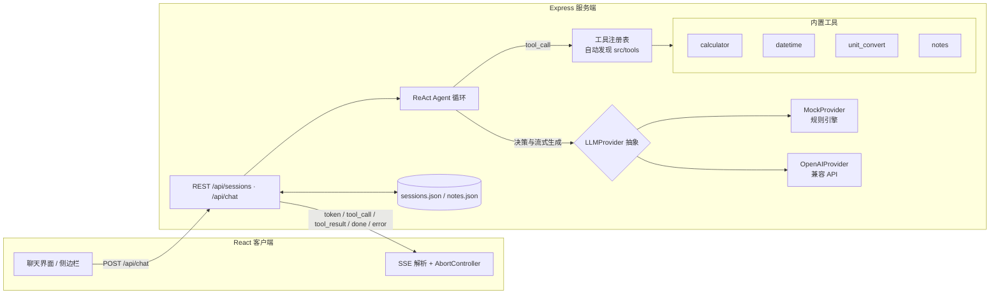

# MindLoop — AI Agent 工作台

MindLoop 是一个前后端分离的 AI Agent 聊天应用：用户发消息，后端以 **ReAct（Reason + Act）循环**驱动 Agent——先规划、再调用工具、观察结果、最后给出回答；全过程通过 **SSE（Server-Sent Events）** 逐 token 流式推送到前端，并以可折叠面板展示 Agent 的思考与工具调用轨迹。

项目开箱即用：**不配置任何 API Key 也能完整体验**（内置 Mock 模型 + 规则引擎），配置 OpenAI 兼容接口后即可切换为真实大模型。

## 特性

- 🌊 **SSE 流式对话**：token 逐个推送，前端打字机效果渲染，支持中途"停止生成"（AbortController）
- 🔁 **ReAct Agent 循环**：plan → tool call → observe → final answer，决策过程以独立事件推送并可视化
- 🧰 **工具注册表（自动发现）**：`server/src/tools/` 下的文件默认导出即注册，内置 4 个工具
  - `calculator`：手写词法/语法分析的安全表达式计算（不使用 eval）
  - `datetime`：当前时间与城市/IANA 时区换算（Node 内置 Intl）
  - `unit_convert`：长度 / 重量 / 温度单位换算
  - `notes`：把备忘追加写入本地 `notes.json`
- 🗂 **多会话管理**：新建 / 切换 / 删除会话，持久化到 `server/data/sessions.json`
- 🔌 **Provider 抽象**：`LLMProvider` 接口 + 两个实现
  - `OpenAIProvider`：OpenAI 兼容 `/chat/completions` 流式接口 + function calling
  - `MockProvider`：零依赖规则引擎，识别"计算 / 时间 / 换算 / 记一下"意图并真实触发工具
- 🌗 **暗色主题前端**：纯手写 CSS（CSS 变量主题），无重型 UI 库；示例问题引导页、消息气泡区分角色

## 架构



事件流约定（`POST /api/chat` 返回 `text/event-stream`）：

| 事件 | data 含义 |
| --- | --- |
| `token` | 回答文本增量 |
| `tool_call` | Agent 决定调用某工具（id / name / args） |
| `tool_result` | 工具执行后的观察结果（id / name / ok / result） |
| `done` | 本轮对话完成 |
| `error` | 出错或被停止 |

## 技术栈

| 层 | 选型 |
| --- | --- |
| 前端 | React 18 + Vite 5 + TypeScript，纯手写 CSS |
| 后端 | Node.js + Express 4 + TypeScript（`tsx` 直接运行，无需单独编译） |
| 通信 | SSE（Server-Sent Events），Vite dev proxy 转发 `/api` |
| 持久化 | JSON 文件（`server/data/`），无数据库 |
| 工程 | npm workspaces + concurrently |

## 快速开始

要求：Node.js ≥ 18（推荐 20+），npm ≥ 9。

```powershell
# 1. 安装依赖（根目录一次装齐）
npm install

# 2. 开发模式：同时启动后端(3001)与前端(5173)
npm run dev
# 浏览器打开 http://localhost:5173

# 3. 构建前端静态产物
npm run build

# 4. 生产模式：后端(3001)会直接托管 client/dist（若已构建）
npm start
# 浏览器打开 http://localhost:3001
```

未配置任何环境变量时，后端自动使用 MockProvider，所有功能（含工具调用）均可演示。

## 接入自己的 OpenAI 兼容 API

通过环境变量切换 Provider（PowerShell 示例）：

```powershell
$env:OPENAI_API_KEY  = "sk-..."                       # 必填，缺省则回落 Mock
$env:OPENAI_BASE_URL = "https://api.openai.com/v1"    # 可选，任何 OpenAI 兼容网关
$env:OPENAI_MODEL    = "gpt-4o-mini"                  # 可选，默认 gpt-4o-mini
npm run dev
```

OpenAIProvider 会把工具注册表转成 function calling schema 传给模型，模型返回的流式 `tool_calls` 增量会被聚合还原并驱动同一套 ReAct 循环。

## 目录结构

```
mindloop-agent/
├── package.json              # workspaces + dev/build/start 脚本
├── README.md
├── LICENSE                   # MIT
├── client/                   # React + Vite 前端
│   ├── vite.config.ts        # /api 代理到 3001
│   └── src/
│       ├── App.tsx           # 状态编排：会话、消息、流式、停止
│       ├── api/client.ts     # REST 封装 + SSE 手工解析
│       ├── components/       # Sidebar / MessageBubble / AgentTrace / Composer / EmptyState
│       └── styles/global.css # 暗色主题（CSS 变量）
└── server/                   # Express 后端
    └── src/
        ├── index.ts          # 入口：API 路由 + 可选静态托管
        ├── agent/react.ts    # ReAct 循环
        ├── provider/         # LLMProvider 接口 + mock / openai 实现 + 工厂
        ├── tools/            # 工具注册表（自动发现）+ 4 个内置工具
        ├── routes/           # sessions CRUD 与 chat SSE
        ├── store/            # sessions.json 持久化
        └── data/             # 运行时数据（gitignore）
```

## 二次开发：如何加一个新工具

1. 在 `server/src/tools/` 新建一个文件，例如 `weather.ts`；
2. 默认导出一个符合 `Tool` 接口的对象：

```ts
import type { Tool } from './types'

const weather: Tool = {
  name: 'weather',
  description: '查询某个城市的天气（演示用，返回固定文案）。',
  parameters: {
    city: { type: 'string', description: '城市名', required: true },
  },
  async run(args) {
    const city = String(args.city ?? '')
    return { ok: true, output: `${city}：晴，24°C（演示数据）` }
  },
}

export default weather
```

3. 保存即可——注册表在启动时自动发现该文件，无需改动其他代码。真实模型（OpenAIProvider）会自动看到新工具的 function schema；若想让 MockProvider 也识别对应意图，可在 `server/src/provider/mock.ts` 的 `detectIntent` 中补一条规则。

## License

[MIT](./LICENSE)
